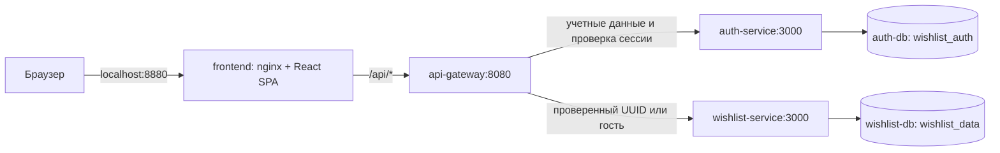

# Wishlist — архитектура MVP

Статус: архитектурное решение для реализации от 2026-10-28; проверяется оркестратором как auto-gate. Основание — утвержденные [требования](requirements.md), [страницы](pages-spec.md), [стек](tech-stack.md), прототип и [локальный запуск](deployment-plan.md).

## 1. Принципы и границы

- Два бизнес-контекста: **идентификация** и **списки желаний**. Регистрация отделена от подарков; списки, подарки и брони остаются вместе, поскольку требуют общей транзакции. Отдельные сервисы подарков, профилей и бронирования не нужны для этого MVP.
- `auth-service` и `wishlist-service` — Node.js 24, Express 5, TypeScript; у каждого собственная PostgreSQL 18 и SQL-миграции. `api-gateway` не имеет БД и бизнес-агрегатов.
- В Compose используются отдельные контейнеры `auth-db` и `wishlist-db`, разные роли/пароли и постоянные тома. Ни один сервис не читает чужую БД; кросс-сервисные FK запрещены.
- UUID — первичные ключи; SQL-имена в `snake_case`; у всех таблиц есть `created_at`, `updated_at` (`timestamptz`). Связи внутри одного контекста имеют FK и соответствующие каскады.
- Браузер работает с относительным `/api`; источником данных становится сервер. `prototype/src/data/mock.ts`, фиктивные аккаунты и хранение состояния вкладки в продуктовую реализацию не переходят.

## 2. Карта компонентов

По умолчанию наружу опубликован только `127.0.0.1:8880`; порты БД и бизнес-сервисов остаются в Docker-сети. Для этапа интеграции допустим временный loopback-порт gateway `127.0.0.1:8080`, без публикации внутренних сервисов. Он не является адресом SPA или `state.baseUrl`.

## 3. Сервисы и данные

| Сервис | Bounded context | База / агрегаты | Обязанности и экраны |
|--------|-----------------|-----------------|----------------------|
| `auth-service` | Идентификация и сессии | `wishlist_auth`: `User`, `Session` | Регистрация, вход, собственный пользователь, выход, внутренняя проверка сессии; `/register`, `/login`, авторизация остальных экранов |
| `wishlist-service` | Списки желаний | `wishlist_data`: `Wishlist` с `Gift` и `Reservation` | Собственные списки/подарки, общая ссылка, атомарная бронь, отмена; `/wishlists`, `/wishlists/:wishlistId`, `/s/:shareToken`, `/r/:reservationToken` |
| `api-gateway` | Входной HTTP-адаптер | Нет БД | Маршрутизация, Origin/CSRF-проверка, аутентификация контекста, лимиты запросов и унификация ошибок |

Минимальные таблицы: `users`, `sessions` в auth; `wishlists`, `gifts`, `reservations` в wishlist. `wishlists.owner_id` — логическая UUID-ссылка на `users.id` без FK. Удаление аккаунта и изменение профиля вне MVP, поэтому репликация пользователей и подписка на изменения профиля не требуются.

Регистрация принимает только email и пароль. `displayName` для собственного кабинета допускается вычислять из локальной части email без нового поля регистрации. Публичные ответы не содержат email, производного от него имени или результатов lookup в auth; UI использует нейтральное «Для близких». Публичный список содержит введенные владельцем название и описание.

## 4. Покрытие маршрутов

| Страница | Данные и действия сервиса |
|----------|---------------------------|
| `/` | Статическая SPA; `auth-service` определяет текущую сессию для перехода в кабинет |
| `/register` | `auth-service`: создание пользователя и сессии; повтор email — конфликт |
| `/login` | `auth-service`: проверка пароля, выдача сессии, безопасный внутренний возврат |
| `/wishlists` | `auth-service`: сессия/выход; `wishlist-service`: список своих вишлистов, создание, изменение, удаление |
| `/wishlists/:wishlistId` | `wishlist-service`: собственный список и подарки, CRUD, чтение и замена общей ссылки; `auth-service`: сессия/выход |
| `/s/:shareToken` | `wishlist-service`: доступ по общей ссылке и создание брони; gateway проверяет имеющуюся сессию для представления владельца |
| `/r/:reservationToken` | `wishlist-service`: чтение конкретной брони и подтвержденная отмена по capability-токену; аккаунт не требуется |
| `*` | Статическая страница 404; `auth-service` используется только для выбора ссылки на главную/кабинет |

Модалки не добавляют маршруты. Все операции изменения — `POST`, `PATCH` или `DELETE`; GET не меняет доменные данные. API-дизайнер фиксирует полные схемы и коды в `docs/{service}/api.yaml` и объединенном `docs/api-gateway.yaml`.

## 5. Авторизация, cookie и доверие между сервисами

1. `auth-service` нормализует email, проверяет пароль длиной 12–128 символов и хранит стойкий хеш. Выбран встроенный асинхронный `crypto.scrypt`: случайная соль 16 байт, `N=32768`, `r=8`, `p=3`, результат 64 байта, `maxmem=64 MiB`; формат хранения включает алгоритм и параметры, сравнение — constant-time. Этот набор соответствует одному из вариантов [OWASP](https://cheatsheetseries.owasp.org/cheatsheets/Password_Storage_Cheat_Sheet.html#scrypt); параметры и соль поддержаны [Node.js 24 crypto](https://nodejs.org/docs/latest-v24.x/api/crypto.html#cryptoscryptpassword-salt-keylen-options-callback). Стоимость проверяется при тестировании на целевом окружении.
2. При регистрации/входе создается строка `sessions` и JWT с `sub=user UUID`, `sid=session UUID`, `iat`, `exp`, фиксированными `iss=wishlist-auth`, `aud=wishlist-web`, алгоритмом `HS256`. Срок сессии и JWT — 24 часа; автоматическое продление и refresh-токены в MVP не нужны.
3. JWT передается только cookie `wishlist_session`: `HttpOnly`, `SameSite=Lax`, `Path=/`, без `Domain`, `Max-Age=86400`. `Secure=false` только для согласованного HTTP localhost; при удаленном HTTPS — `true`. JWT отсутствует в JSON, `localStorage` и `sessionStorage` браузера.
4. Gateway извлекает cookie и вызывает закрытый `POST /internal/sessions/validate` auth-service с JWT и внутренним credential. Auth проверяет подпись/claims, срок и отсутствие отзыва строки сессии. Положительный результат не кэшируется: выход немедленно отзывает текущую сессию, удаляет cookie и не завершает другие сессии.
5. Gateway удаляет все поступившие от клиента `X-Internal-*`, `X-User-*` и не доверяет клиентскому Bearer/user-id. Он сам добавляет `X-Internal-Token` из конфигурации и только проверенный `X-User-Id`. Wishlist-service требует этот credential и валидирует UUID; на закрытых операциях дополнительно проверяет `owner_id`. Auth-service также защищает внутренние маршруты credential. Секреты сравниваются безопасно и не имеют встроенного значения по умолчанию.
6. Для просмотра общей ссылки и бронирования отсутствие cookie означает гостя. Если cookie присутствует, gateway обязан проверить ее: недействительная сессия дает `401`, недоступный auth — `503`; переход к анонимному представлению при сбое запрещен. UI предлагает повторный вход либо явный выход для просмотра как гость. Идемпотентный logout допускает очистку истекшей/некорректной cookie; при сбое auth не сообщает об успешном отзыве действующей сессии.
7. Секретная ссылка брони — независимое полномочие: ее чтение/отмена не зависят от JWT, общей ссылки или работоспособности проверки сессии. Владение аккаунтом не предоставляет токены отмены.

Для каждого небезопасного запроса через gateway, включая регистрацию, вход, гостевую бронь и отмену, обязателен точный `Origin=APP_ORIGIN` и заголовок `X-Requested-With: Wishlist`; JSON-тело принимается только с `application/json`, размер ограничен 32 KiB. Межсайтовый CORS не включается. Отсутствующий/чужой Origin отклоняется с `403`; внутренние запросы авторизуются отдельным credential и не публикуются через `/api/internal`. Это дополняет SameSite-cookie и защищает cookie-авторизацию от CSRF. Frontend всегда использует `credentials: 'same-origin'`.

## 6. Гарантии Wishlist

- **Цена:** `price_kopecks BIGINT CHECK (price_kopecks BETWEEN 0 AND 9007199254740991)`, валюта `RUB`. Во внешнем JSON — явно названный `priceKopecks`, безопасное целое число; форма преобразует рубли/копейки из десятичной строки без двоичного округления. Пустая/отрицательная/нечисловая цена отклоняется. Название обязательно; URL/заметка опциональны, лимиты и схемы ссылок проверяет сервер.
- **Границы владения:** каждый запрос списка/подарка связывается с проверенным `owner_id`; чужой и отсутствующий объект получают одинаковый `404`. Responses управления строятся явной проекцией: нет статусов, счетчиков или идентификаторов броней и секретов. Ошибки и подтверждения удаления также не раскрывают наличие брони.
- **Общая ссылка:** 32 случайных байта в base64url, уникальный `share_token`. Значение доступно только владельцу и обладателю ссылки, хранится в закрытой БД сервиса, исключено из журналов. Атомарная замена дает новый токен и немедленно закрывает старый, не затрагивая подарки/брони. Публичный lookup не возвращает `owner_id` и закрытые данные пользователя.
- **Представление владельца:** wishlist-service сравнивает проверенный `X-User-Id` с владельцем даже на публичном endpoint и не выбирает/не возвращает доступность для него; ответ явно содержит `isOwner`, а поле доступности подарков присутствует только для гостя/посетителя чужого списка. Идентификатор списка позволяет владельцу перейти к управлению без раскрытия `owner_id`. Сервер запрещает бронирование своего подарка с действующей сессией. Анонимный владелец неотличим от гостя — согласованное ограничение сохраняется.
- **Единственная бронь:** `reservations` имеет `gift_id` FK и частичный уникальный индекс по `gift_id WHERE canceled_at IS NULL`. Создание выполняется одной транзакцией; конфликт уникальности возвращает `409`, не раскрывая чужих данных. Бронь не имеет срока истечения.
- **Порядок блокировок:** все изменения агрегата сначала блокируют строку wishlist (`FOR UPDATE`), затем нужный gift. Создание брони повторно проверяет действующий `share_token` под этой блокировкой; удаление/смена ссылки/добавление 101-го подарка не обходят инварианты при гонках. Одинаковый порядок блокировок предотвращает взаимную блокировку этих операций.
- **Отмена:** новый секрет — 32 случайных байта base64url; в БД только `SHA-256(token)` с уникальным индексом. Открытый токен возвращается единожды после успешного создания и не включается в публичные/владельческие ответы. `POST` отмены устанавливает `canceled_at` только у найденной по хешу брони; повторная отмена безопасна. Новая бронь того же подарка имеет другой секрет, старая ссылка ее не меняет.
- **Изменение/удаление:** `gifts.version` увеличивается при правке; бронь хранит `gift_version` на момент создания. Секретный GET возвращает актуальную карточку и признак изменения. Удаление gift каскадно удаляет его брони, удаление wishlist — подарки и брони; старые секреты получают нейтральный `404`.
- **Потеря ответа:** UI блокирует повторную отправку до результата. После сетевой неопределенности создания брони нет автоматического повторного POST или обещания восстановить секрет; показывается неопределенность и обновляется доступность. Серверный уникальный индекс гарантирует отсутствие второй активной брони при любом повторе. Отмена по секрету идемпотентна; по общей ссылке секрет не восстанавливается. Это соответствует утвержденным состояниям страниц и не требует хранения открытых секретов для replay.

## 7. Межсервисные ссылки и события

| Связь / событие | Источник | Потребитель и доставка в MVP |
|----------------|----------|------------------------------|
| Проверка `Session` → UUID пользователя | auth-service | Синхронный закрытый HTTP-запрос gateway на каждом запросе, где требуется идентичность; таймаут и fail-closed |
| `Wishlist.owner_id` → пользователь | wishlist-service | Только логическая ссылка; без FK, запроса чужой БД, публичного lookup или копии email |
| `UserRegistered`, `SessionCreated`, `SessionRevoked` | auth-service | Внешних подписчиков нет; изменения транзакционны в auth, кеша сессий нет |
| `WishlistCreated`, `ShareLinkRotated`, `GiftChanged`, `GiftDeleted` | wishlist-service | Внутренние доменные факты; связанные инварианты выполняются в той же БД, не через асинхронную проекцию |
| `GiftReserved`, `ReservationCanceled` | wishlist-service | Доступность выводится из БД при чтении; уведомления и внешние подписчики отсутствуют |

Брокер, outbox и фиктивная очередь не создаются: межсервисных read-моделей, требующих доставки событий, в MVP нет. Таблица фиксирует доменные события и отсутствие их публикации; надежность доставки не заявляется. При появлении внешних подписчиков потребуется отдельное решение с outbox и идемпотентным потребителем.

## 8. Gateway, эксплуатация и проверка

- Gateway снимает префикс `/api` и проксирует только явно разрешенные маршруты auth и wishlist; внутренние URL и произвольный proxy запрещены. `Set-Cookie` от auth сохраняется; секреты и внутренние заголовки в ответы не попадают. Сетевой сбой upstream — `503`, timeout — `504`, не подмена на `404` и не HTML SPA.
- Лимиты MVP в gateway: вход/регистрация — 20 попыток за 15 минут на IP; создание броней — 60 в минуту на IP; секретные lookup/cancel — 120 в минуту на IP; превышение — `429` с `Retry-After`. В одном локальном экземпляре счетчики в памяти, после перезапуска сбрасываются; распределенная защита не заявляется. Нельзя доверять произвольному клиентскому `X-Forwarded-For`: доверяется только известный nginx из сети Compose.
- Frontend nginx обслуживает SPA, проксирует `/api/*` и не пишет токены маршрутов `/s/*`, `/r/*` или API в access log; запросы к магазинам не идут через backend. Ответы с пользовательскими данными — `Cache-Control: no-store`, `Referrer-Policy: no-referrer`, `X-Robots-Tag: noindex, nofollow`. Ошибки возвращают безопасные код/сообщение и request-id без stacktrace, URL-токенов или тела.
- `JWT_SECRET`, `INTERNAL_TOKEN` и пароли БД генерируются для локального запуска и хранятся в игнорируемом `.env`, без секретов/рабочих паролей в git или встроенных fixtures. Миграции запускаются перед приемом трафика; перезапуск контейнеров не удаляет тома. До внешнего запуска нужны проверенные backup/restore; локальная документация включает резервное копирование обеих БД.
- Все сервисы имеют `/health`; бизнес-сервисы подтверждают соединение со своей БД. Проверки backend выполняются на настоящем PostgreSQL для гонок, FK/каскадов и сохранности. Проверяются отзыв сессии, подстановка внутренних заголовков, чужие объекты, скрытие owner-статусов, смена ссылки, гонка брони и отмена старым секретом.
- `state.baseUrl` устанавливается только после работающего frontend и smoke через тот же origin (`/health`, `/api/auth/me` и закрытый ресурс без cookie → `401`, не `404`). Затем Playwright проходит все утвержденные маршруты и сценарии против этого полного адреса. До этих результатов приложение не отмечается развернутым или завершенным.
